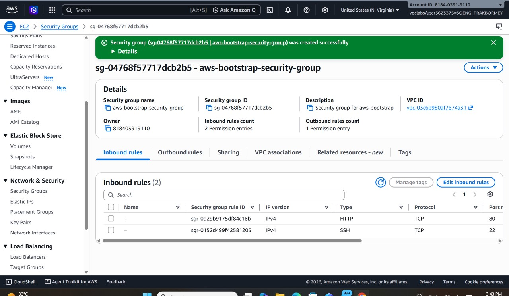
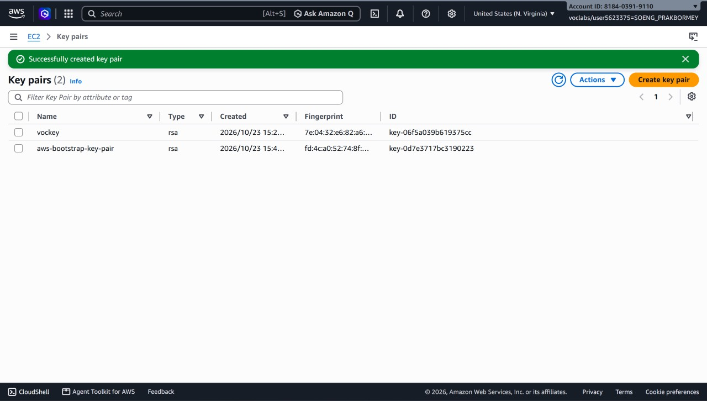
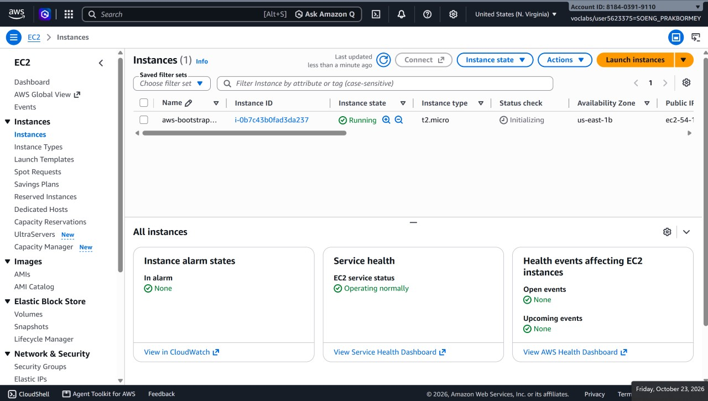
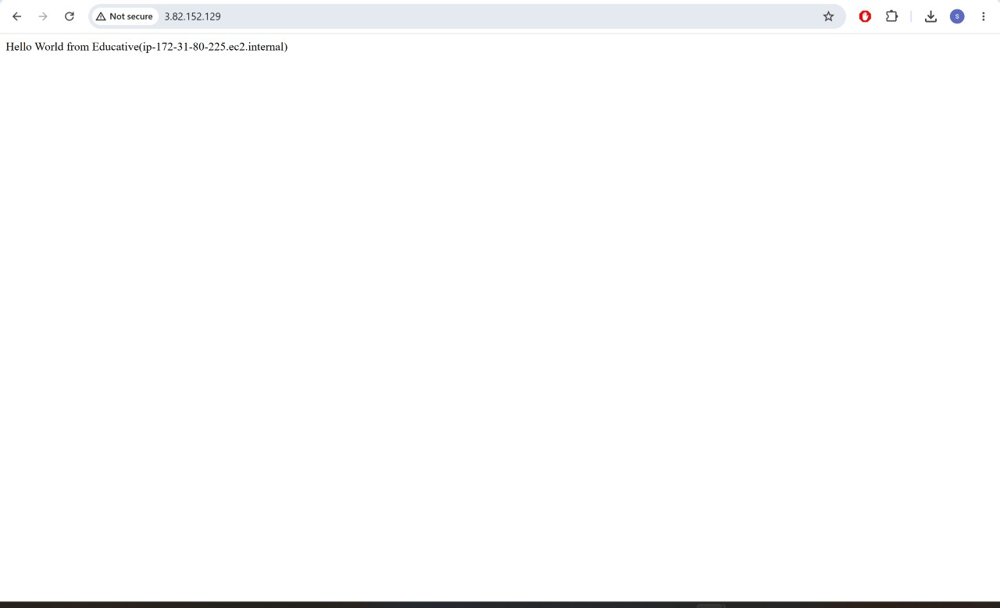
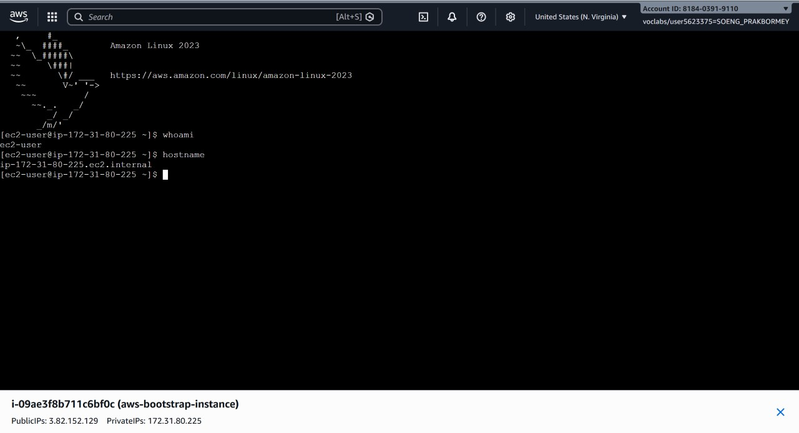
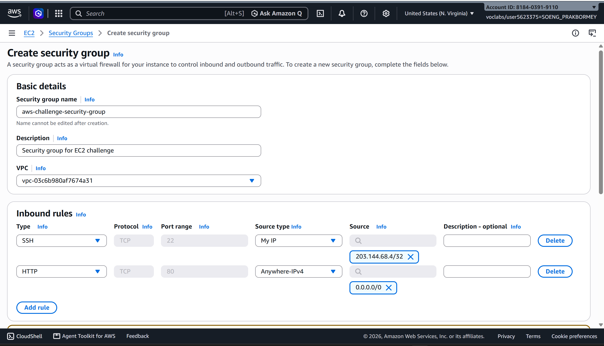
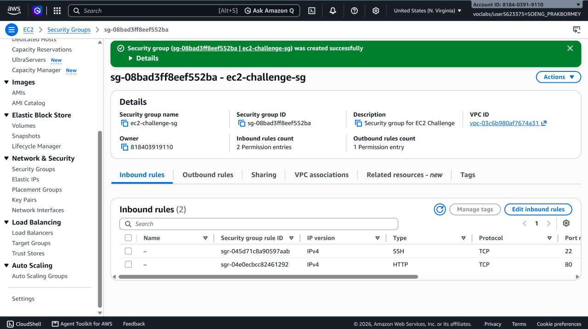
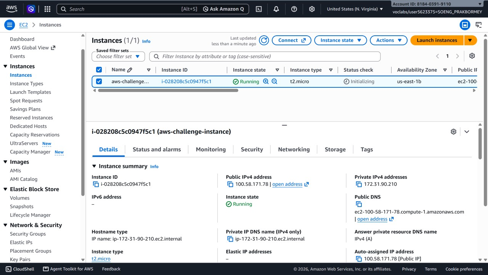
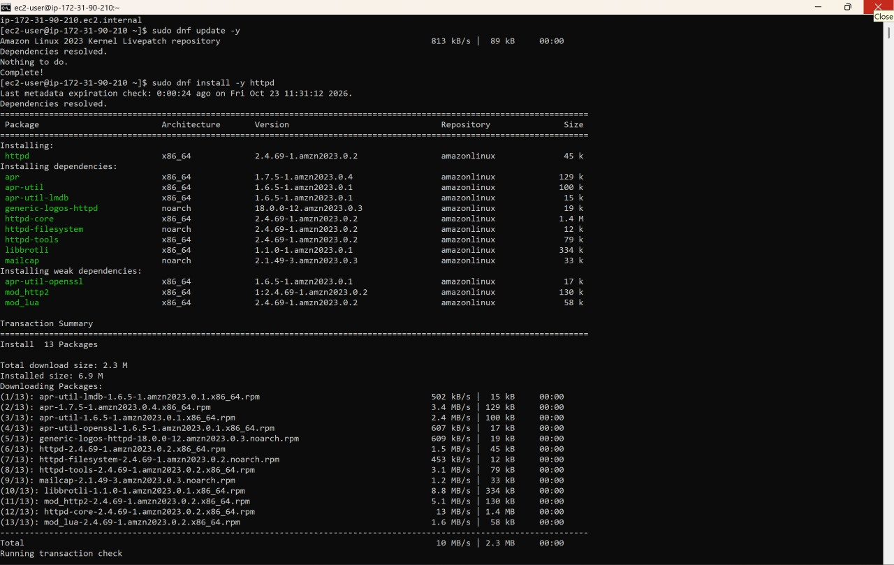
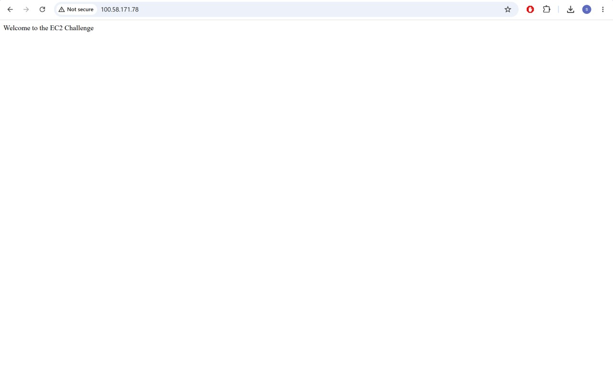

# Cloud Lab 1 Submission — Amazon EC2

Copy this template to `cc-lab-YOUR_ID/lab1/README.md` in your own repository. Follow [the instructions](lab1-instruction.md). Put your screenshots in `lab1/images/` with the file names below.

- **Student name: SOENG Prakbormey**
- **Student ID: e20221730**
- **Learner Lab user name: SOENG_PRAKBORMEY**
- **Date completed: 23/10/2026**

---

## Part 1.1 — An Amazon EC2 Walkthrough

### Security group



### Key pair



### Instance details



### Browser test



### SSH connection



Did you connect with your own SSH client or with EC2 Instance Connect?

---

## Part 1.2 — EC2 Web Solution (Challenge)

### Launch configuration



### Security group



### Running instance



### Commands on the instance



Paste the commands you ran to install the web server and create `index.html`:

```bash

```

### Browser test



---

## Questions

1. Your security group has an SSH rule and an HTTP rule. What does each one let you do? What would stop working if you deleted the HTTP rule?
   
   The SSH rule allows me to connect to the EC2 instance remotely on port 22, for example by using SSH or EC2 Instance Connect. The HTTP rule allows web browsers to connect to the web server on port 80. If I deleted the HTTP rule, the web page would no longer open through the instance's public IP address because incoming web traffic would be blocked. SSH access would still work as long as the SSH rule remained.

2. In Part 1.1 you never logged in to install the web server. What installed it, and when did it run?
   
   The EC2 user data script installed the web server. AWS ran this script automatically during the first boot of the instance, before I opened the web page. The script installed and started the web server and created the web page without requiring an SSH login.

3. Why does the web page open with `http://` but not with `https://`?
   
   The web server is configured for HTTP on port 80, so `http://` works. HTTPS needs a web server listening on port 443 and a valid SSL/TLS certificate. This lab did not configure HTTPS, port 443, or an SSL/TLS certificate, so `https://` does not work.

4. Part 1.2 asked for a 10 GiB root volume. Where in the launch settings did you set it, and how can you check the size on the running instance?
   
   I set it in the launch settings under **Configure storage**, by changing the root volume (`/dev/xvda`) size to **10 GiB**. In the running instance, I can check the disk size with `lsblk` or `df -h`. For example:

   ```bash
   lsblk
   df -h /
   ```

   These commands show the root disk and its size. I can also check it in the AWS console by opening **EC2 → Instances → Storage**, selecting the instance, and viewing the size of its root EBS volume.

## Problems and how I solved them (optional)

## AI note (optional)

One suggestion an AI tool gave you and how you checked it.

## Clean up

- [ ] Part 1.1: instance terminated, key pair and security group deleted.
- [ ] Part 1.2: instance terminated, security group (and key pair, if any) deleted.