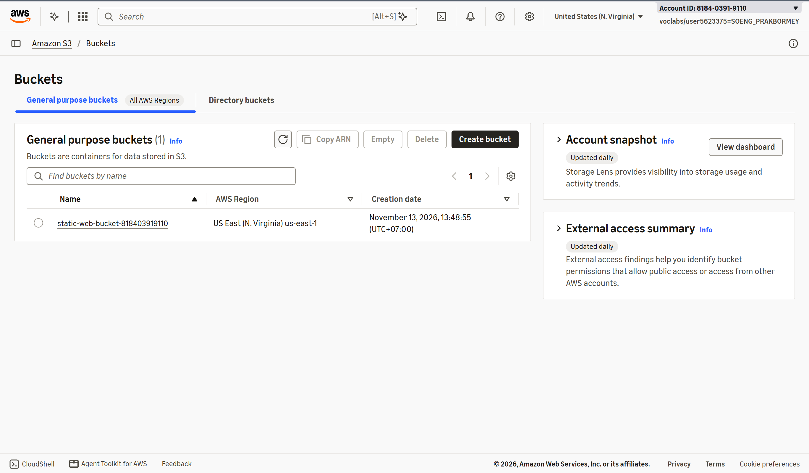
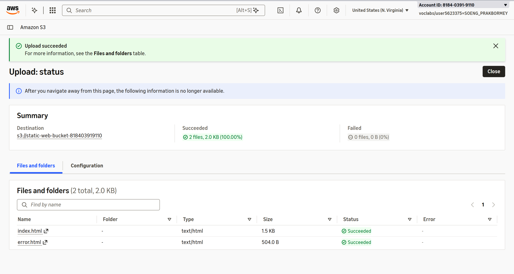
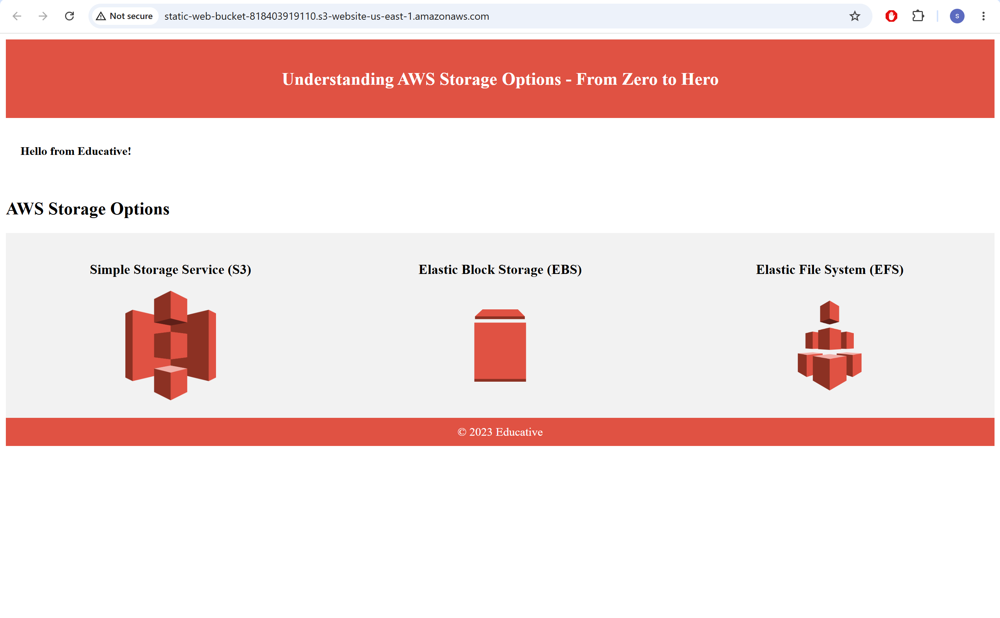
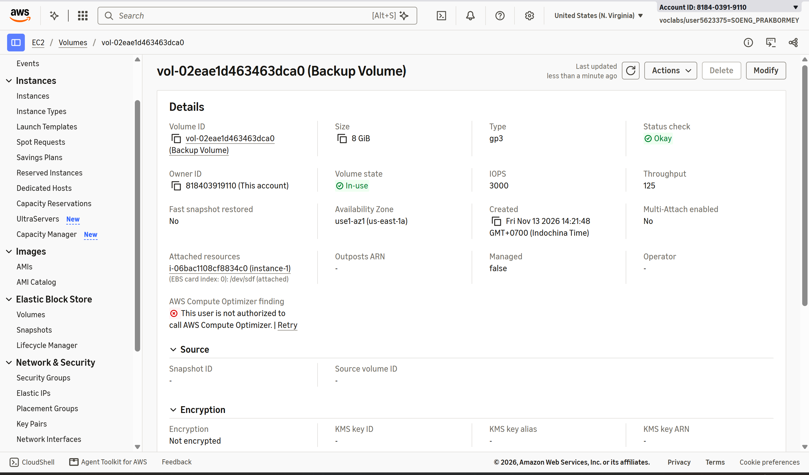
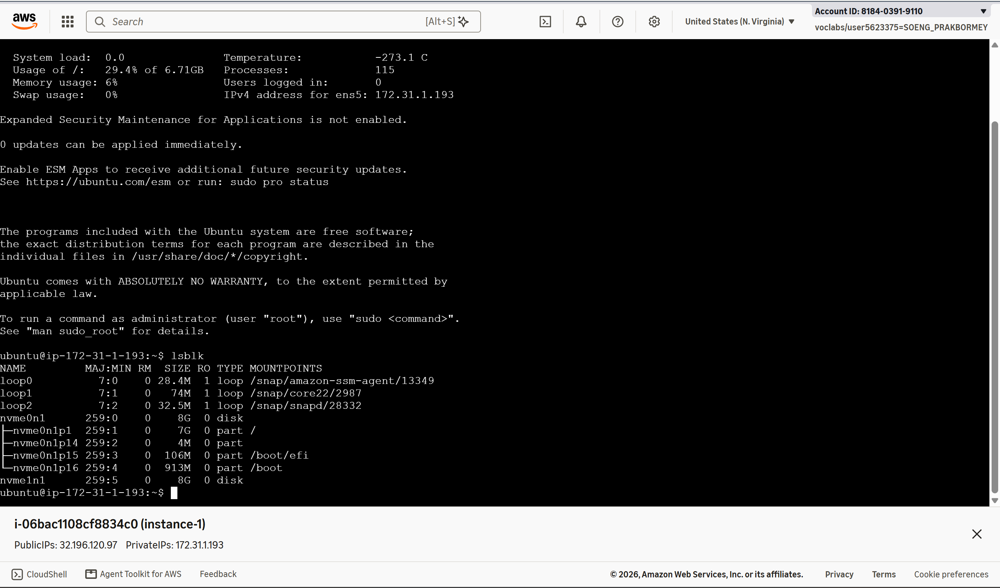
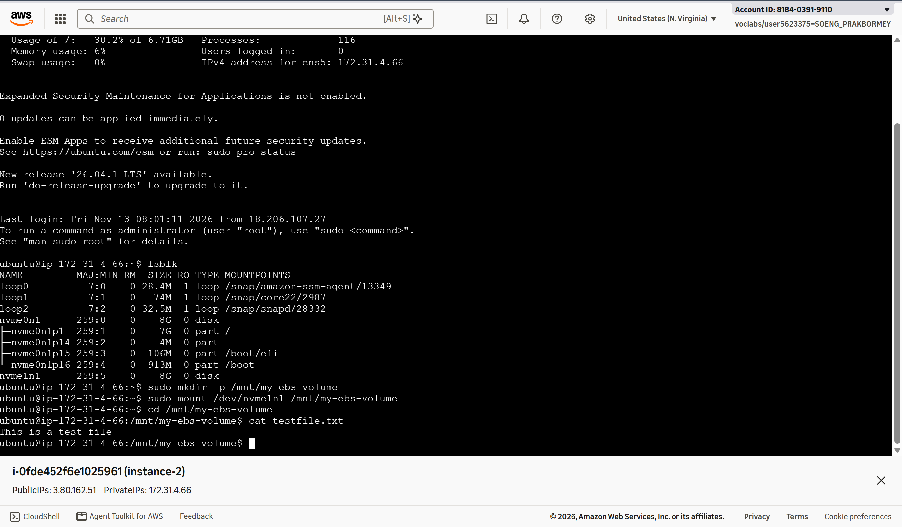
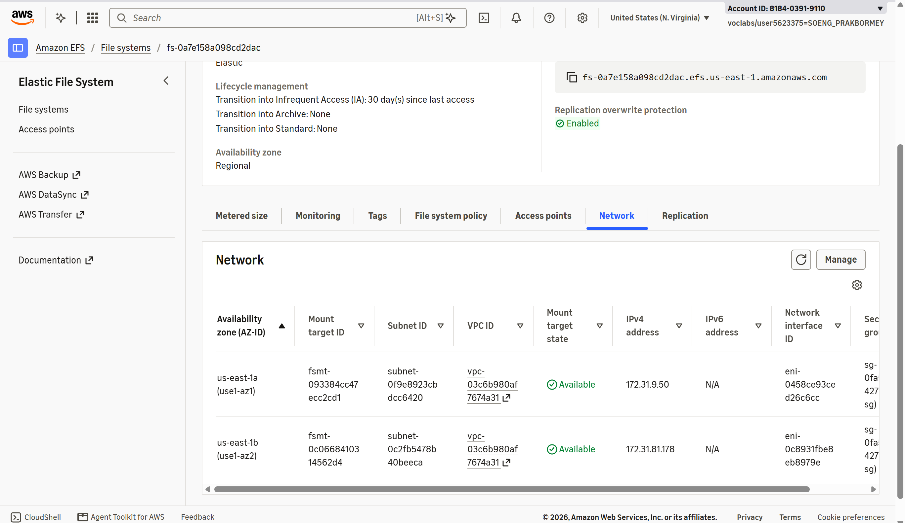
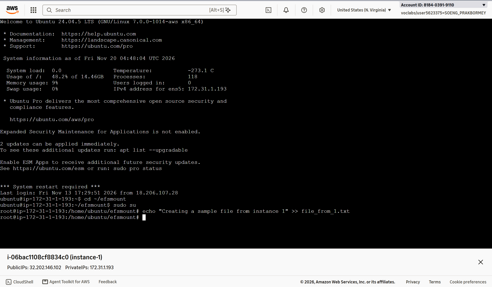
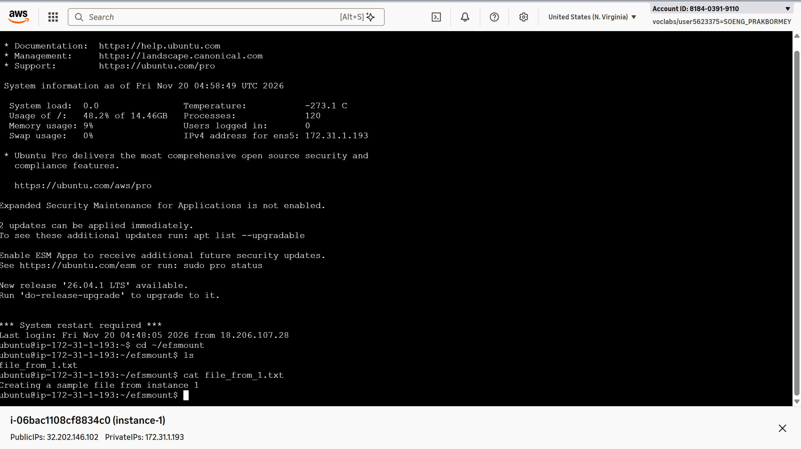

# Cloud Lab 3 Submission — AWS Storage Options

## Student information

- **Student name:** Borme
- **Student ID:** E20221730
- **Learner Lab user name:** E20221730
- **Date completed:** 2026-11-20

## Part 2.1 — Amazon S3

### Bucket list

### Uploaded files

### Static website

## Part 2.2 — Amazon EBS

### Volumes page

### Attached volume (`lsblk`)

### File read on instance-2

### Which device name did your volume get?

The volume appeared as `nvme1n1` on the instance. Device names can be different depending on the instance type and the virtualization used by AWS. For example, an `xvdf` device may appear as an NVMe device inside the operating system.

## Part 2.3 — Amazon EFS

### File system and mount targets

### File created on instance-1

### File listed on instance-3

## Questions

### 1. Why did the static website first answer `403 Forbidden`?

The S3 bucket was private at first. The website endpoint could find the bucket, but it was not allowed to read the website files, so it returned `403 Forbidden`.

After the bucket policy was added, it allowed public read access to the objects in the bucket. The endpoint could then read and display the website files.

### 2. What happened to files on the root volume after terminating instance-1?

`testfile.txt` stayed available because it was saved on the separate EBS `Backup Volume`. The volume was detached from instance-1 and attached to instance-2, so the data stayed on that volume.

A file saved on instance-1's root volume would normally be deleted when instance-1 was terminated. The root EBS volume is usually configured with `DeleteOnTermination`, so both the instance and its root disk are removed. This is why important data should be stored on a separate volume or another storage service.

### 3. Why did you run `mkfs` on instance-1 but not on instance-2?

The new EBS volume did not have a file system, so `mkfs` was needed to format it before it could be mounted and used.

After the volume was detached and attached to instance-2, the file system and data were still on the volume. Running `mkfs` again would format the volume again and could erase the existing file. Therefore, instance-2 only needed to mount the volume.

### 4. Why could instance-1 and instance-3 use EFS at the same time?

EFS is a network file system designed for shared access. Multiple EC2 instances can mount the same EFS file system and read or write files at the same time.

An EBS volume is different because it behaves like a disk attached to one instance at a time in this lab. It had to be detached from instance-1 before it could be attached to instance-2.

The instances needed network access to the EFS mount targets in their subnets. A mount target provides the network connection between EFS and an EC2 instance in that Availability Zone. The security groups also had to allow NFS traffic on port 2049. Without a reachable mount target and the correct network permissions, the instances could not mount EFS.

### 5. Which storage service is best for each need?

| Need | Best service | Reason |
|---|---|---|
| (a) A website's images | **S3** | S3 stores objects reliably and can serve static images over the web. It also scales without managing a server disk. |
| (b) The disk of a database server | **EBS** | EBS provides block storage that can be attached to an EC2 database server and used as a normal disk. |
| (c) A folder shared by several web servers | **EFS** | EFS can be mounted by many EC2 instances at the same time, so all web servers can use the same files. |

## Problems and how I solved them

The main issue was understanding the difference between the three storage services. I checked the result after each step: the S3 website endpoint, the EBS device with `lsblk`, the file after moving the EBS volume, and the shared file from the second EFS instance. These checks confirmed that each service was being used for the correct purpose.

## AI note

One suggestion was to run `mkfs` on the EBS volume again after attaching it to instance-2. I did not follow that suggestion because the volume had already been formatted and contained `testfile.txt`. I checked the existing file system and mounted the volume instead. Formatting it again could have deleted the file.

## Clean up

- Instances `instance-1`, `instance-2`, and `instance-3` were terminated.
- `clab-efs` and `Backup Volume` were deleted.
- Security groups `efs-sg` and `ec2instances-sg` were deleted.
- The S3 bucket was emptied and deleted.
