# Cloud Lab 4 Submission — Amazon VPC

Copy this template to `cc-lab-YOUR_ID/lab4/README.md` in your own repository. Follow [the instructions](lab4-instruction.md). Put your screenshots in `lab4/images/` with the file names below.

- **Student name: Soeng Prakbormey**
- **Student ID: e20221730**
- **Learner Lab user name: SOENG_PRAKBORMEY**
- **Date completed: 11/06/2026**

---

## VPC and internet gateway

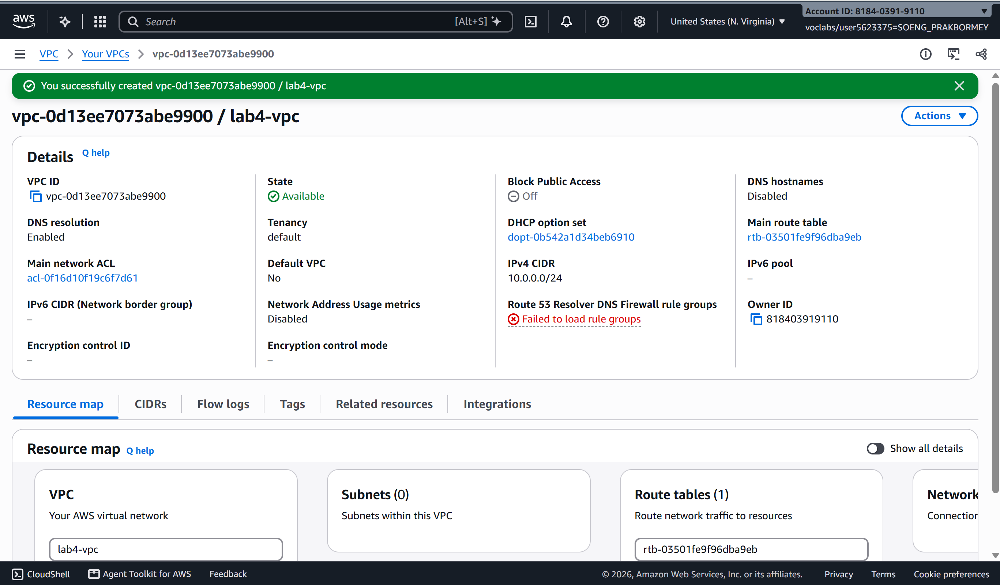

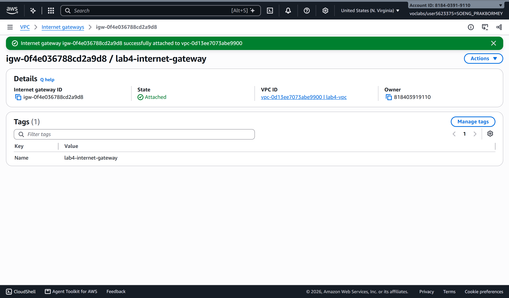

## Public subnet

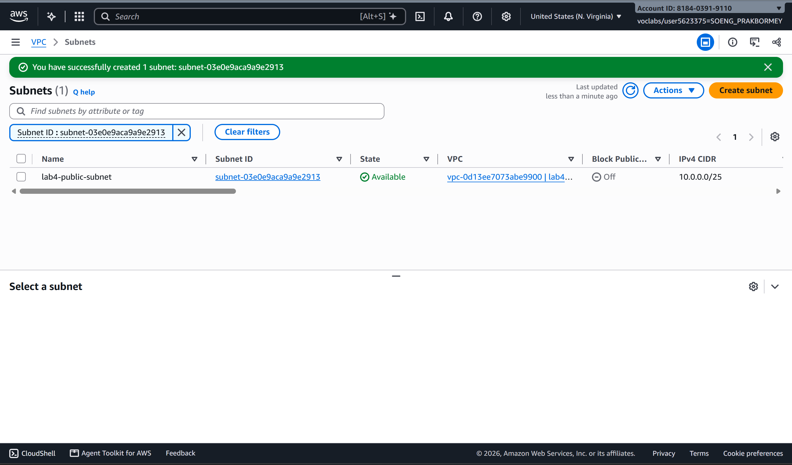

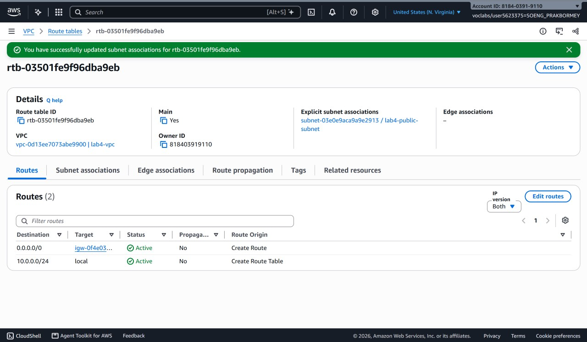

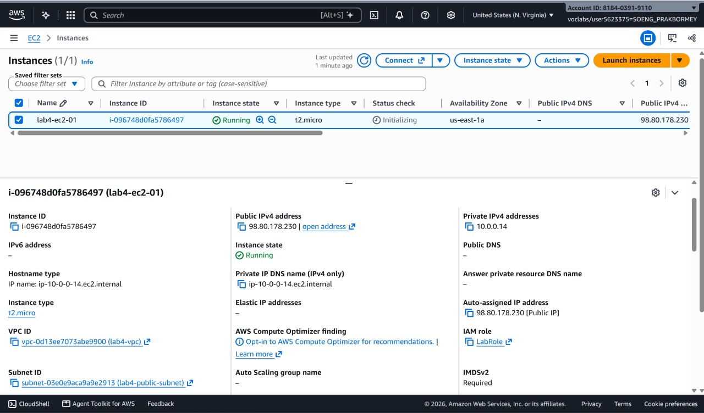

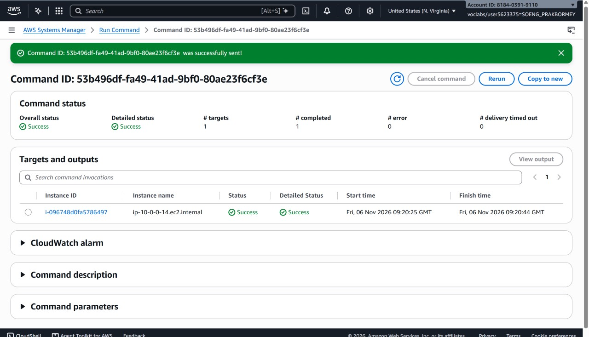

## Private subnet

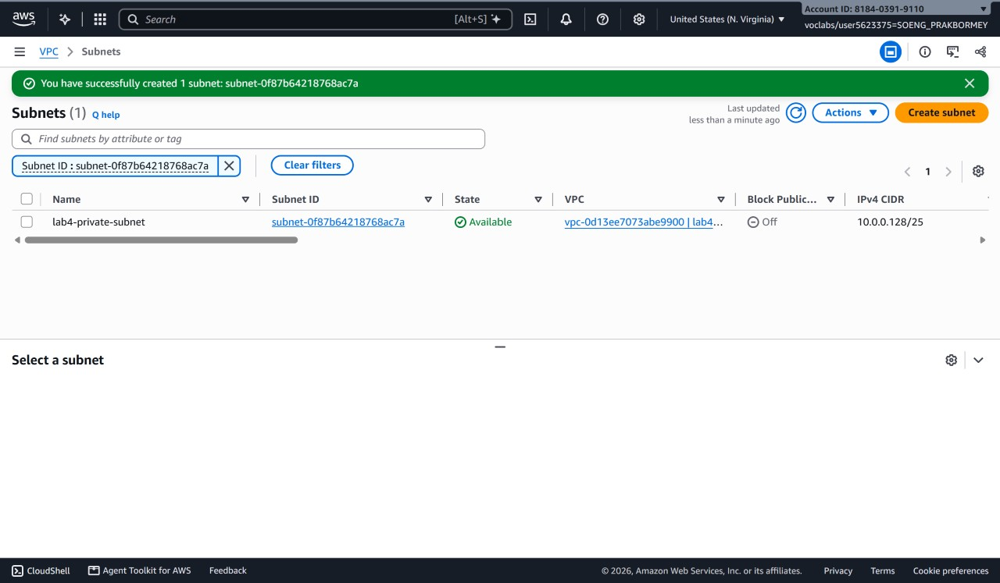

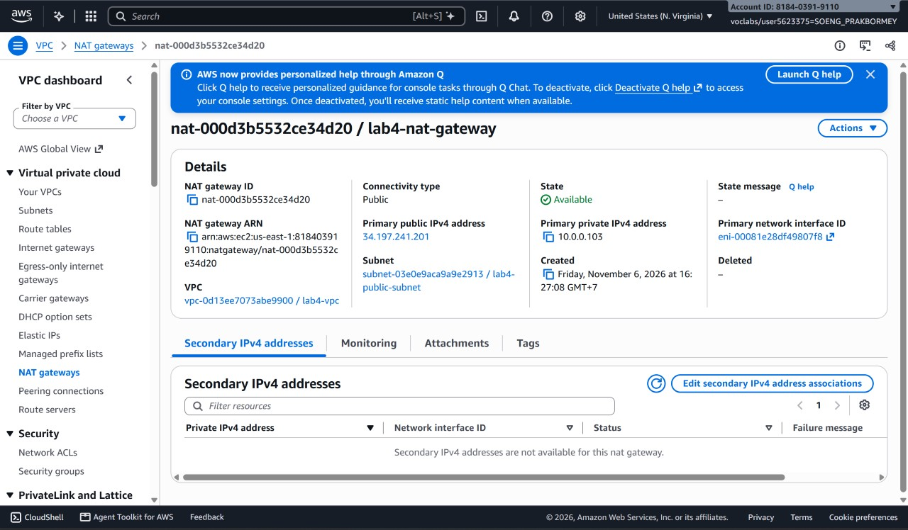

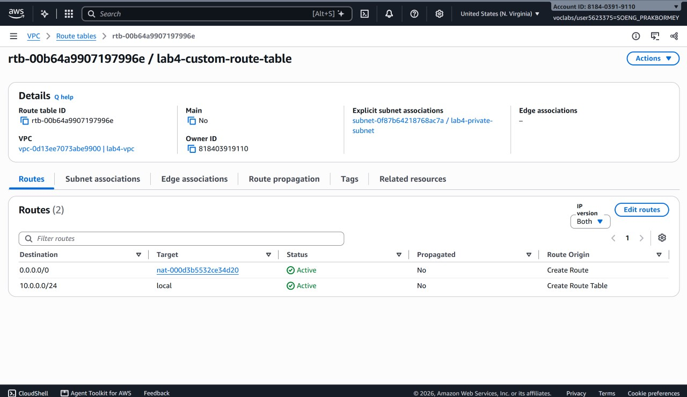

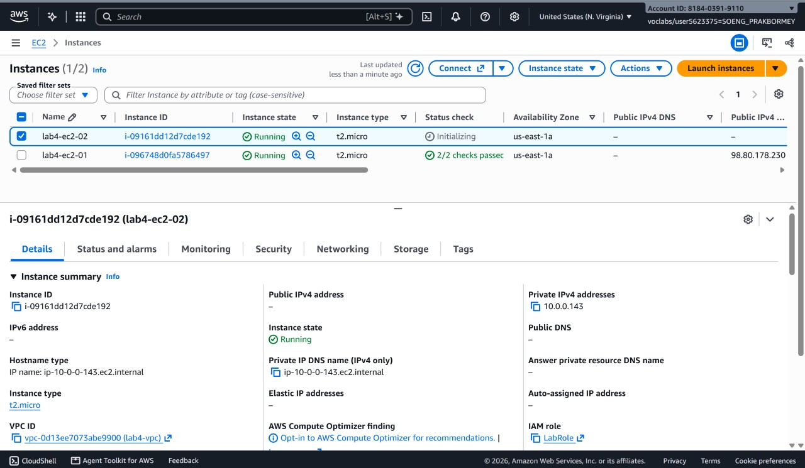

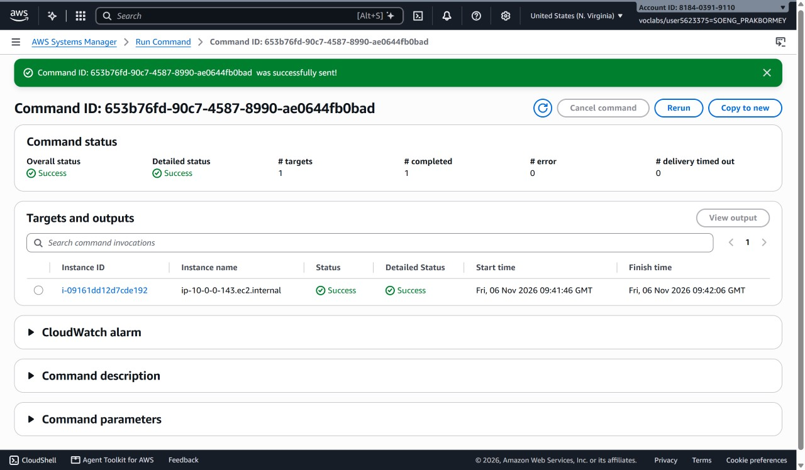

---

## Questions

1. The VPC is `10.0.0.0/24` and the subnets are `10.0.0.0/25` and `10.0.0.128/25`. How many IP addresses does each block contain, and why do the two subnets not overlap?

   A `/24` block contains 256 IP addresses. Each `/25` subnet contains 128 IP addresses. The first subnet covers `10.0.0.0` to `10.0.0.127`, and the second covers `10.0.0.128` to `10.0.0.255`, so they use separate ranges and do not overlap. AWS reserves five addresses in each subnet, so 123 addresses in each subnet are normally available for resources.

2. Both subnets are in the same VPC. What exactly makes `lab4-public-subnet` public and `lab4-private-subnet` private?

   The public subnet's route table sends internet-bound traffic (`0.0.0.0/0`) to the Internet Gateway. The private subnet's route table sends that traffic to the NAT Gateway instead. Therefore, the public subnet can have direct internet access, while the private subnet cannot receive direct connections from the internet.

3. Why is the NAT gateway placed in the **public** subnet and not in the private one?

   A NAT Gateway needs a route to the Internet Gateway so it can send traffic to the internet. Placing it in the public subnet gives it that route and a public Elastic IP. A NAT Gateway in the private subnet would not have a direct path to the internet.

4. `lab4-ec2-02` has no public IP address. Can someone on the internet open a connection to it? Can it download updates? Explain both answers.

   No, someone on the internet cannot open a direct connection to `lab4-ec2-02` because it has no public IP and the NAT Gateway only allows return traffic for connections started from inside. Yes, it can download updates: the instance sends the request to the NAT Gateway, and the NAT Gateway sends it to the internet. The response then comes back through the NAT Gateway.

5. You tested internet access with Systems Manager instead of SSH. Why did the instances need `LabInstanceProfile` for this?

   `LabInstanceProfile` gives the EC2 instances an IAM role with permission to use Systems Manager. The SSM Agent uses this role to connect the instances to AWS Systems Manager, so we can open a session without SSH keys or a public IP address.

## Problems and how I solved them (optional)

## AI note (optional)

One suggestion an AI tool gave you and how you checked it.

## Clean up

- [ ] Instances terminated.
- [ ] NAT gateway deleted and its Elastic IP released.
- [ ] Internet gateway detached and deleted.
- [ ] `lab4-vpc` deleted.