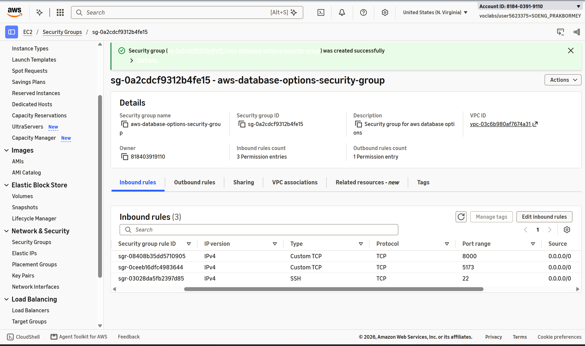
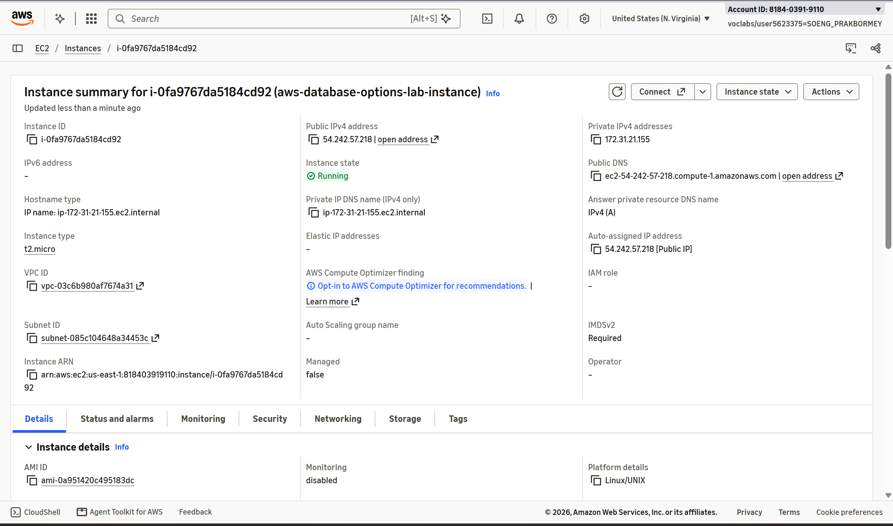
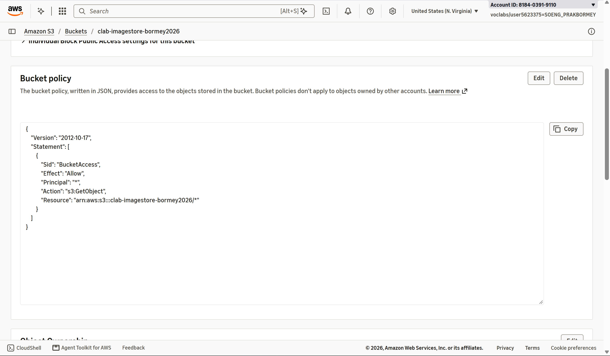
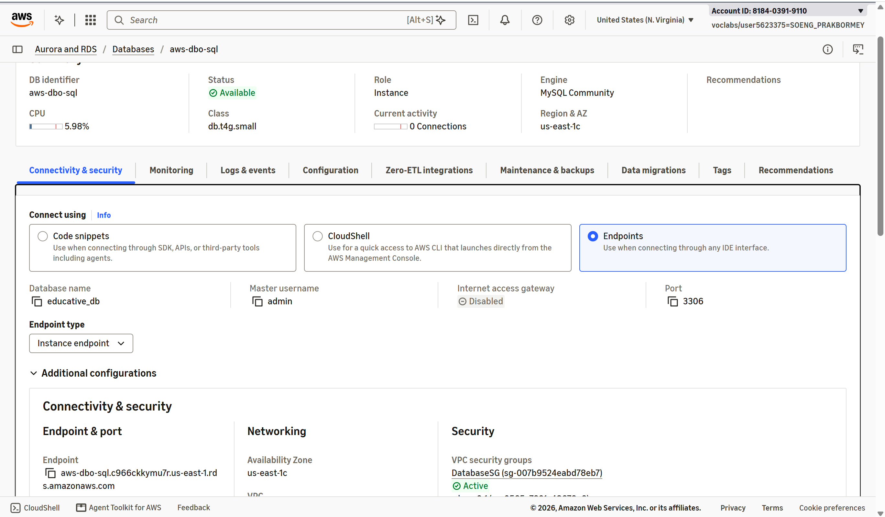
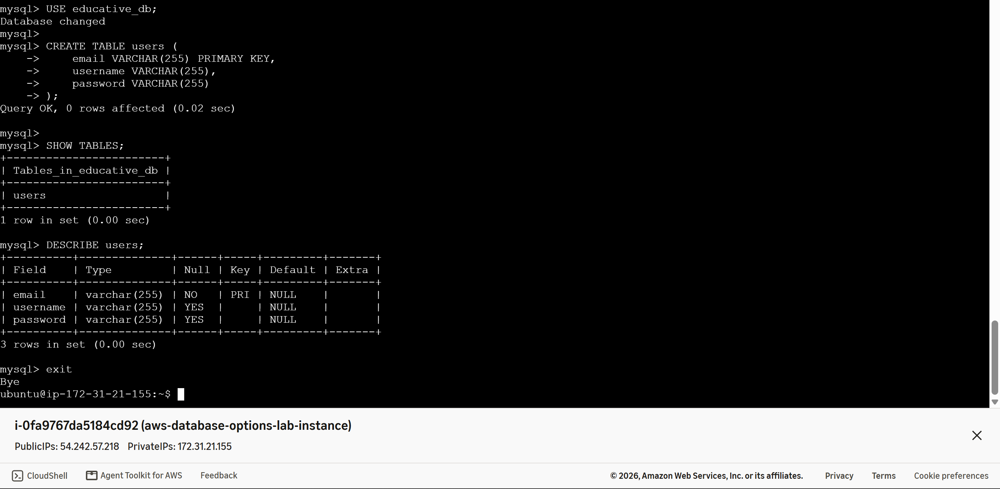
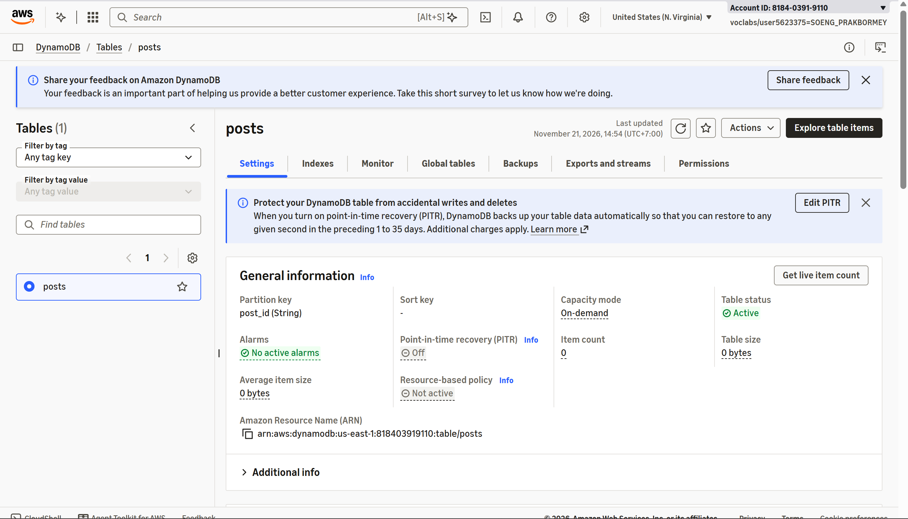
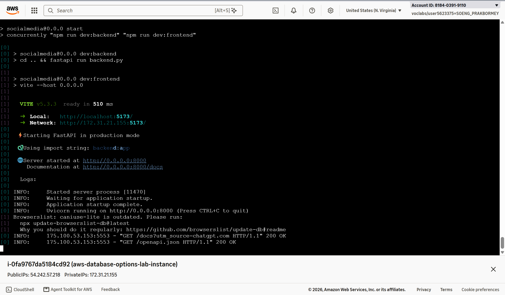
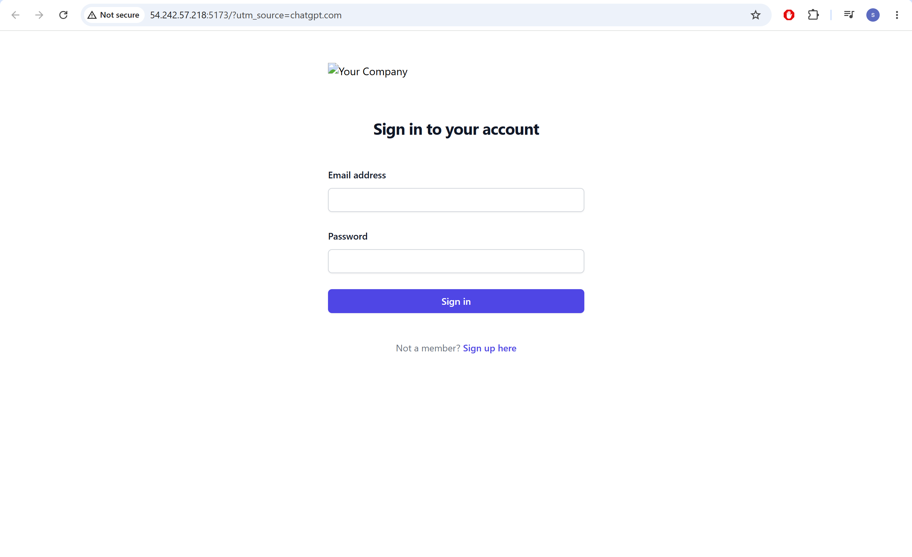
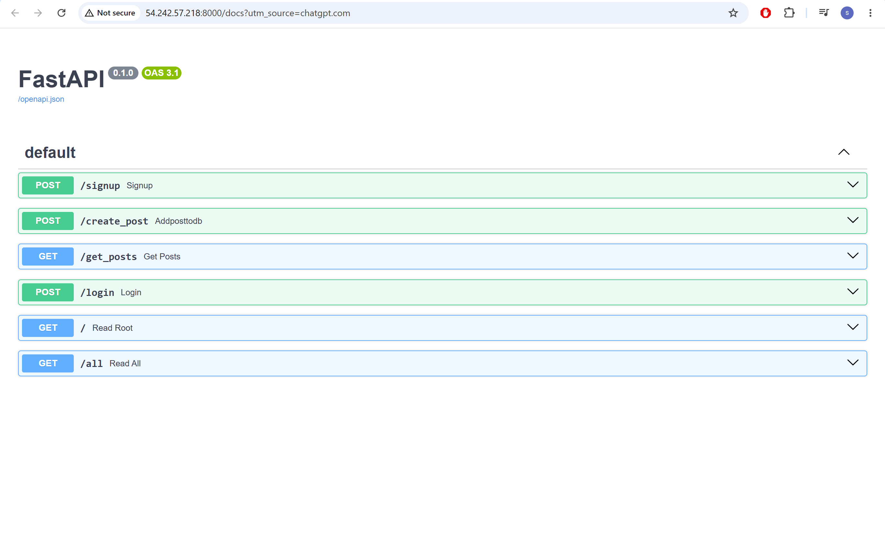
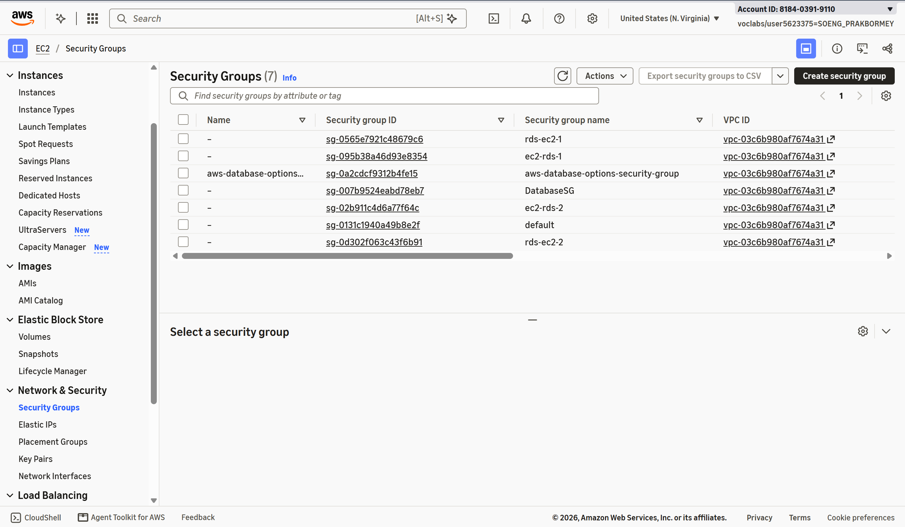

# Cloud Lab 5 Submission — AWS Database Lab

Copy this template to `cc-lab-YOUR_ID/lab5/README.md` in your student repository. Follow [the lab instructions](lab5-instruction.md) and save your screenshots in `lab5/images/` with the file names below. This report is the single document that holds all your screenshots. Each heading labels the screenshot under it.

- **Student name:**
- **Student ID:**
- **Learner Lab user name:**
- **Date completed:**

Make sure resource names, statuses and endpoints are readable in every screenshot. Never show your database passwords or the AWS access key, secret key or session token.

---

## 1. Security Group Rules

`aws-database-options-security-group` with its inbound rules (SSH port 22, Custom TCP ports 8000 and 5173) and its outbound rule.

## 2. EC2 Instance Running

`aws-database-options-lab-instance` in the **Running** state with `aws-database-options-security-group` attached.

## 3. S3 Bucket

Your `clab-imagestore-…` bucket with its public access settings and bucket policy visible.

## 4. RDS DB Instance

`aws-dbo-sql` with the status **Available** and its endpoint visible.

## 5. Aurora DB Status

The `aws-dbo-aurora` cluster with the status **Available** and its writer and reader endpoints visible.

## 6. DynamoDB Table

The `posts` table with the status **Active** and its partition key `post_id` visible.

## 7. Application Configuration and Testing

The EC2 instance terminal after `npm start`, showing that the application started.

The application running in your browser at `http://<Public_IP_of_EC2>:5173`, with the address bar visible.

Optional: the signup or login page and a sample post. Delete the image line below if you did not take this screenshot.

## 8. Final Infrastructure

One collage of the resources you created: EC2 instance, security group, RDS and Aurora databases, DynamoDB table and S3 bucket.

## Errors and troubleshooting (optional)

Screenshots of any error messages you met, and what you did about them.

---

## Questions

1. Signup writes to the Aurora **writer** endpoint and login reads from the **reader** endpoint. Your cluster has no Aurora Replica. Which instance answers the reader endpoint, and why does the application still work?

   **Answer:** The Aurora writer instance answers the reader endpoint because the cluster does not have a separate reader replica. Aurora sends the read request to the only available DB instance. The application still works because the writer instance can perform both read and write operations. The disadvantage is that there is no separate instance to share the read workload.

2. A post is split between the `user_post` table in RDS and the `posts` table in DynamoDB. What does each one store, and how does `/get_posts` join them?

   **Answer:** The `user_post` table in RDS stores the relational information that connects a user to a post, such as the username and `post_id`. The DynamoDB `posts` table stores the actual post content, using `post_id` as its key. The `/get_posts` route first reads the user's post IDs from RDS. It then uses those IDs to read the matching post content from DynamoDB and combines the two results before returning them to the application.

3. The post ID is the username followed by the time (`%H:%M:%S`). What happens if the same user publishes two posts in the same second, or on two different days at the same time?

   **Answer:** Both posts receive the same `post_id` because the ID does not contain a date or a smaller time unit. This creates a collision. If DynamoDB receives another item with the same key, the new item can replace the old item, so the first post may be lost. The same problem happens on different days if the user publishes at the same time, because the date is not included in the ID.

4. Why does the post content go into DynamoDB instead of a SQL table, according to the lab's database design?

   **Answer:** The lab uses SQL for structured relational data, such as users and the relationship between users and posts. DynamoDB is used for the post content because it is a key-value/document database that can store flexible post data and scale quickly when many posts are created. This design also keeps the user relationship data separate from the content data.

5. The `users` table stores the password exactly as the user typed it, and the S3 bucket allows anyone to read its objects. Name one risk of each choice.

   **Answer:** Storing passwords as plain text is dangerous because anyone who gets access to the database can immediately read and use the users' passwords. Passwords should be stored as secure hashes instead. A public S3 bucket can expose private files to anyone on the internet, which can cause data leaks or unauthorized downloads.

## Clean up

- [ ] EC2 instance terminated and `aws-database-options-security-group` deleted.
- [ ] RDS instance `aws-dbo-sql` and Aurora cluster `aws-dbo-aurora` deleted.
- [ ] S3 bucket emptied and deleted.
- [ ] DynamoDB table `posts` deleted.